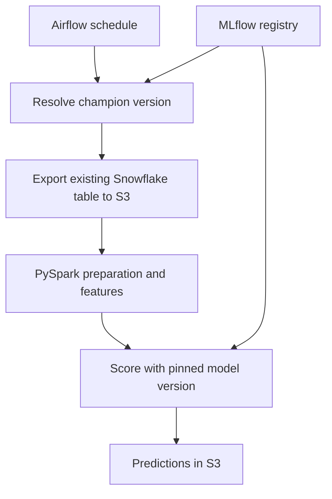

# Credit card churn: a beginner-friendly Python / PySpark POC

**Current POC:** score 2,000,000 existing Snowflake records using the MLflow champion model. Airflow runs five shell-script tasks: resolve the champion, export the existing table to S3, prepare data, engineer features, and score. Scheduled runs do not recreate the Snowflake table, train a model, or register a new version.

**Deployment:** native Python virtual environments and Linux services on EC2. GitHub Actions tests and packages source, uploads it to S3, and deploys through AWS Systems Manager. No Docker image or ECR publication is used by the current workflow. See [the native deployment guide](docs/native-deployment.md) for rollout steps, file locations and rollback behavior.

## What you are building



The complete stack runs on one EC2 machine for this POC. Airflow is the scheduler; S3 holds data; Snowflake is the source; MLflow preserves experiments, model versions and the champion alias. This is **batch deployment**.

## Legacy bootstrap and Docker reference

The sections below retain the original synthetic-data bootstrap, training and Docker setup instructions for reference. They are not the native production deployment procedure. For the migrated EC2 host and current CI/CD workflow, follow [docs/native-deployment.md](docs/native-deployment.md).

| Step | File | Output |
|---|---|---|
| Synthetic source ingestion | `churn/snowflake_io.py` (cloud) or `churn/generate.py` (local) | Historical + current snapshots |
| Snowflake to S3 export | `churn/snowflake_io.py` | Snappy Parquet |
| Data preparation | `churn/prepare.py` | Validated, typed rows; quality report |
| Feature engineering | `churn/features.py` | 14 numeric features; train/validation/test split |
| Train and register | `churn/train.py` | Spark model, MLflow metrics, exact model-version manifest |
| Batch scoring | `churn/score.py` | Customer probability, decision, model version |
| Schedule | `dags/churn_pipeline.py` | Daily 08:00 IST by default |

## 1. Prerequisites

For local testing: Docker Desktop using Linux containers on Windows, or Docker Engine + Compose v2 on Linux; a Python 3 interpreter is used only to create `.env`. The actual jobs use the Python interpreter inside Docker, so your Windows `python` vs `py` version difference does not affect Spark.

Check in VS Code PowerShell:

```powershell
docker version
docker compose version
py --version
```

Docker's server must be running. Start with 10,000 rows if your machine is small. Suggested full-run host: 8 vCPU, 32 GiB RAM, 100 GiB disk, with 4 Spark threads and a 4 GiB Java driver initially. This is a starting configuration, not a guaranteed runtime or memory requirement. Cloud deployment needs AWS and Snowflake access and permission to create the listed resources.

## 2. Open the extracted project and configure it

Open **the folder containing `compose.yaml`** in VS Code. Run:

```powershell
py scripts/init_env.py
```

Linux / EC2 equivalent:

```bash
python3 scripts/init_env.py
```

Open `.env`. For the first run set `ROWS=10000` and keep `PIPELINE_MODE=local`. The initialization script generates random passwords. Your Airflow login is the `AIRFLOW_ADMIN_USER` and `AIRFLOW_ADMIN_PASSWORD` values. Never commit `.env` or `secrets/`.

## 3. Build and start services, in this order

These commands work in PowerShell and Bash:

```text
docker compose build
docker compose run --rm --no-deps permissions
docker compose up -d postgres mlflow
docker compose run --rm airflow-init
docker compose up -d airflow-webserver airflow-scheduler
docker compose ps
```

The first build downloads dependencies and may take several minutes. The permissions step initializes writable Docker volumes. Airflow metadata uses PostgreSQL. MLflow uses SQLite with one server worker for this POC and stores artifacts in a persistent Docker volume. Both applications bind only to `127.0.0.1` on the host.

Open:

- Airflow: <http://localhost:8080>
- MLflow: <http://localhost:5000>

## 4. Run the small end-to-end test

Airflow UI → `credit_card_churn_poc` → unpause the DAG → trigger it. Watch these six boxes turn green:

`ingest`, `export`, `prepare`, `features`, `train`, `score`.

In **local mode**, ingest generates local Parquet and export is an explicitly logged bypass; Snowflake and S3 are not exercised. This is intentional for setup testing. All model stages run normally. Cloud mode activates the real Snowflake-to-S3 path.

For a manual run independent of the Airflow scheduler:

```powershell
./scripts/run_local.ps1 -Rows 10000 -RunId demo_small
```

If your PowerShell policy blocks scripts, run this directly in the terminal instead:

```powershell
foreach ($s in @("ingest","export","prepare","features","train","score")) {
    docker compose run --rm runner -m churn.cli $s --mode local --rows 10000 --run-id demo_small
    if ($LASTEXITCODE -ne 0) { break }
}
```

Linux:

```bash
bash scripts/run_local.sh 10000 demo_small
```

Avoid running a manual job and an Airflow run simultaneously on a small machine.

## 5. Inspect your result

For the manual run named `demo_small`:

```text
docker compose run --rm runner -c "from pathlib import Path; print(Path('/opt/airflow/work/demo_small/scores/summary.json').read_text())"
docker compose run --rm runner -c "from pathlib import Path; print(Path('/opt/airflow/work/demo_small/model/manifest.json').read_text())"
```

Airflow runs use the `ts_nodash` timestamp shown in task logs as their folder name. Inspect the corresponding folder instead of `demo_small`.

In MLflow, open experiment `credit-card-churn-poc`: inspect ROC-AUC, PR-AUC, precision, recall and F1; then open registered model `credit_card_churn`. The POC promotes a model passing its ROC-AUC gate to alias `champion`. Scoring reads an immutable numeric model version, recorded in `model/manifest.json`, so an alias change during scoring cannot change that run.

Predictions are **multiple Parquet part-files** inside `scores/predictions/`. They collectively form one dataset. Do not use `coalesce(1)` for 2 million rows just to get one filename.

## 6. Run 2 million customers

Set `ROWS=2000000` in `.env`. Recreate the Airflow services so they read the new environment:

```text
docker compose up -d --force-recreate airflow-webserver airflow-scheduler
```

Trigger another DAG run. Or run manually:

```powershell
./scripts/run_local.ps1 -Rows 2000000 -RunId demo_2m
```

The project generates **two snapshots of 2 million customers**, so 4 million source rows total: historical labeled rows for training and a separate unlabeled scoring snapshot. Training uses approximately 80% / 10% / 10% customer splits. Scoring outputs exactly 2 million rows. The ZIP contains the generator, not millions of embedded records; the command above creates the full dataset on your machine.

## 7. Deploy to AWS and enable Snowflake

Follow `docs/AWS_AND_SNOWFLAKE.md` in order. It includes CloudFormation, Docker deployment, S3 permissions, Snowflake integration trust, key-pair authentication and a cloud smoke test. Once successful, set:

```dotenv
PIPELINE_MODE=cloud
ROWS=2000000
```

Recreate the Airflow services, then trigger the DAG. Keep the EC2 host running for scheduled jobs. Docker restarts the services after a reboot, but a stopped EC2 instance cannot run Airflow.

## 8. Scheduling and reuse

The DAG schedules at **08:00 Asia/Kolkata daily** and allows only one active run and one task at a time. This leaves time to investigate before 14:00; it does not guarantee a 14:00 delivery. `catchup=False` avoids historical backfills. Trigger manually for the deadline demo instead of waiting for the first scheduled run. The cron schedule expresses the run time; Airflow's logical date/data interval can refer to the preceding period. Synthetic scoring uses execution date by default.

For Mondays only, change `DAG_SCHEDULE=0 8 * * 1` and recreate the scheduler. No reminder or separate ChatGPT automation is created by this project.

The first run requires `TRAIN_MODEL=true`. After a successful run, set `TRAIN_MODEL=false` to reuse `champion`. The `train` task then resolves the alias once and writes an exact version manifest instead of retraining. To retrain for the demo, set it back to true. A real deployment should use separate schedules and approval gates for retraining and scoring.

## GitHub and automated CI/CD

The current `.github/workflows/ci-cd.yml` runs native tests and packages source for S3/SSM deployment to EC2. Follow [docs/native-deployment.md](docs/native-deployment.md). The earlier `docs/GITHUB_CICD.md` describes the legacy Docker/ECR setup; its repository and OIDC concepts remain useful, but its image deployment instructions are superseded. Keep `ENABLE_DEPLOY=false` during the migration review.

## Where to go next

- `docs/DATA_AND_MODEL.md`: business definition, feature dictionary, leakage prevention and modeling limits.
- `docs/AWS_AND_SNOWFLAKE.md`: cloud deployment steps and cleanup.
- `docs/TROUBLESHOOTING.md`: fixes for common errors.
- `docs/DEADLINE_PLAN.md`: priorities before your demo.
- `docs/VALIDATION.md`: exact checks performed by ChatGPT and their limits.
- `docs/SOURCES.md`: official references.
